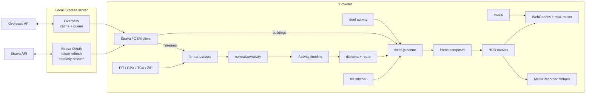

# JejakLari Studio

A personal project for turning a running activity into a **9:16 3D map video**. Load a FIT, GPX,
TCX, or Strava run and render a chibi runner moving through a map diorama with a telemetry HUD,
Overpass buildings, cinematic cameras, music, and an optional **1 vs 1 duel**.

Rendering, parsing, export, and audio run in the browser. A small Express server handles the two
things a static client cannot safely do alone: the Strava client-secret OAuth exchange and a
cached/rate-limited Overpass proxy. Activity files stay in the browser; Strava streams are fetched
only when you select an activity, and tokens stay in server memory.

This is a personal project, built and maintained for my own runs. It is not a hosted product and
is not affiliated with Strava, OpenStreetMap, or any map provider.

## What works

| Capability | Status |
| --- | --- |
| FIT / GPX / TCX parsing, ZIP and gzip archives | Working (real Garmin FIT fixture in tests) |
| Normalization: timestamps, jumps, elevation gain, HR/cadence fallbacks | Working |
| Real map backdrop: Esri satellite, OSM streets, CyclOSM topo, CARTO dark | Working, with offline canvas fallback |
| 3D diorama: map texture, route ribbon, progress glow, km markers, start/finish beacons | Working |
| Procedural chibi runner: gender, six hair styles, seven accessories, outfit colors | Working |
| Camera presets: Follow, Drone, Front, Side, Chase + intro orbit + finisher shot | Working; tight shots track at compressed video speed |
| HUD: pace/HR/cadence/elevation, progress, distance, time, mini-map, km callouts | Working |
| Finisher recap card and duel scoreboard | Working |
| 1 vs 1 race: second activity, ghost placement, live gap, result by time or pace | Working |
| Export: MP4 H.264 + AAC, 720×1280 or 1080×1920, 30 fps, deterministic frame stepping | Working (WebCodecs + mp4-muxer) |
| Export fallback: WebM VP9/VP8 + Opus via MediaRecorder | Working |
| Music: built-in 96 BPM synth beat, uploaded audio, volume/mute, fade-out | Working |
| Download current frame as PNG | Working |
| Uploaded music (decoded, looped, faded, encoded AAC) | Working; verified by 440 Hz tone analysis |
| Overpass 3D buildings (footprints, height/levels, roof/wall colors, merged mesh) | Working, toggleable, cached |
| Strava OAuth (local secret), recent run list, stream import, refresh, revoke | Working; mock-verified end to end |

The complete app lives in this repository: the browser studio, the local API bridge, tests, sample
activities, and documentation. Reverse-geocoded street names, OSM road/area layers, a multi-camera
editor, and cloud sharing are outside the current scope.

## Quick start

Requires Node.js 20.19+ (or 22.12+) and a Chromium-based browser (Chrome/Edge 119+) for MP4 export.

```sh
npm install
cp .env.example .env   # optional: fill Strava/Overpass values
npm run dev
# http://127.0.0.1:5187/
```

`npm run dev` starts the Express API *and* Vite middleware on one port. Production:

```sh
npm run build
npm start              # same server, serves dist/
# or: npm run preview
```

Without a `.env`, every local feature except Strava works; the Strava panel explains the missing
configuration. `.env` is gitignored.

The app ships with:

- `public/samples/sample-5k.gpx` — synthetic 5 km morning run around GBK Senayan, Jakarta.
- `public/samples/rival-5k.gpx` — same loop, 30 seconds faster, for duel mode.
- `public/samples/sample-run.fit` — real 5.38 km Garmin run (test data from
  [jimmykane/fit-parser](https://github.com/jimmykane/fit-parser), MIT).

## Usage

1. **Pelari** — load a file or connect Strava, set the runner name/BIB, style the character.
2. **Tanding** — load a second activity (or the ghost rival) for 1 vs 1.
3. **Peta** — choose map style, sky mood, camera preset, video duration, and toggle OSM buildings.
4. **Export** — choose 720p/1080p, music, then export. The MP4 downloads when rendering completes.

Preview controls: play/pause, scrub, and the five camera chips under the phone frame.
The video timeline is always intro (3.5 s or 25% of duration) → run → finisher (4 s or 25%).

## Architecture



- **Domain** (`src/domain`) — pure activity model, parsers (including Strava streams), normalization, race.
- **Engine** (`src/engine`) — geo math, tiles, OSM building geometry, scene, runner, camera, HUD,
  timeline, audio, exporter.
- **API client** (`src/api`) — same-origin Strava/Overpass calls; no secrets.
- **Server** (`server/`) — Express API: Strava OAuth/token refresh/session cookies, activity and
  stream proxy, Overpass query/cache/queue. Vite middleware only in dev.
- **UI** (`src/ui`) — React studio shell; owns no rendering logic.
- **Seams** — parsers, map styles, camera poses, exporters, and OAuth/Overpass services are
  replaceable behind narrow interfaces. Server tests inject a mock `fetch`; UI tests can intercept API.

## Verification

```sh
npm test        # 33 tests: domain, Strava, Overpass, geometry, camera tracking
npm run build   # typecheck client + server + production bundle
```

Rendered and probed end to end in Chromium:

| Test | Result |
| --- | --- |
| 15 s, 720×1280 | H.264 Baseline, 450 frames @30 fps, AAC 48 kHz stereo, 15.02 s |
| 15 s, 1080×1920 | H.264 Baseline, 450 frames, AAC, 15.02 s |
| 30 s duel, 720×1280 | H.264, 900 frames, AAC, 30.02 s; rival pixels present |
| 12 s fallback | VP9 + Opus WebM, 720×1280 |
| Offline map | "Peta offline" fallback canvas, app remains usable |
| Header upload while another tab is open | File chooser + FIT parse verified |
| Map tile density | 1.9 km sample uses z17 (2,304×1,792 texture, 1.19 m/px) instead of z15 (1,792×1,536, 4.75 m/px); 126 tiles loaded in 3.7 s |
| Intro camera | 1.9 km route starts at ~575 m altitude instead of the ~4,238 m drone overview |
| Finish layout | Recap card occupies the bottom ~20% solo / ~27% with a duel instead of a full-screen wash; runner and map stay visible |
| Overpass live | 1,200 buildings loaded in 2.3 s from the Asia mirror; toggle changed the WebGL frame hash; stale-cache and sanitized-504 tests pass; 15 s export with buildings ~2 s |
| Strava bridge | Mock OAuth: auth URL/state, token exchange, run filtering, streams, single-flight refresh, revoke, disconnect, origin guard |
| Strava UI | Intercepted status/list/streams responses; import replaced the activity and normalized 4.2 km |
| Production server | Built `dist/` served with API status 200 and SPA fallback HTML |

Details in [docs/verification.md](docs/verification.md).

## Strava setup

1. Create an API application at <https://www.strava.com/settings/api>.
2. Set **Authorization Callback Domain** to `127.0.0.1` (Strava white-lists localhost/127.0.0.1).
3. Copy `.env.example` to `.env` and fill:
   - `STRAVA_CLIENT_ID`
   - `STRAVA_CLIENT_SECRET`
   - `STRAVA_REDIRECT_URI=http://127.0.0.1:5187/api/strava/callback` (must match exactly)
4. Restart `npm run dev`, open `http://127.0.0.1:5187`, then **Pelari → Strava → Hubungkan Strava**.

Scopes requested: `read,activity:read_all`. The browser receives only an httpOnly session cookie;
the client secret and refresh token remain in server memory. Tokens are intentionally not persisted:
restarting the server requires reconnecting. Disconnect revokes the token at Strava when reachable.
Only `Run`, `TrailRun`, and `VirtualRun` activities are listed; import uses Strava streams
(`latlng`, `time`, `distance`, `altitude`, `heartrate`, `cadence`).

## 3D buildings (Overpass)

**Peta → Bangunan 3D** auto-queries Overpass for the route bbox (with 130 m padding), caches the
result server-side for one hour, and extrudes footprints using `height` / `building:levels`.
Buildings are one merged, vertex-colored mesh; the toggle removes/re-adds it without rebuilding the
scene. Area is capped (0.25° span, 0.03 deg²), responses at 1,200 buildings, and the server runs one
Overpass query at a time.

Defaults: the Asia mirror `ovp.dresel.systems/api-as`, falling back to `maps.mail.ru` and
`overpass-api.de`; override with `OVERPASS_URL` / `OVERPASS_FALLBACK_URL` (fallbacks are
comma-separated) and identify the app with `OVERPASS_USER_AGENT`. An empty result from a regional
mirror falls through to the next endpoint. A failed refresh reuses the last cached result for the
same area and the panel says `data OSM terakhir`; provider errors are reduced to
`host: timeout (504)` instead of raw HTML. If no cached result exists, the route still renders and
the panel reports the compact failure with a retry. Wait for the `bangunan 3D aktif` status before
exporting; a render started during the query omits buildings.
OSM data is ODbL; respect the public instance usage policies (cache, no parallel bulk scripts).

## Browser and network notes

- WebCodecs requires a secure context; `localhost` qualifies. MP4 export needs H.264 encoding
  support (Chrome/Edge). Other browsers get the WebM fallback.
- Map tiles are fetched from Esri, OpenStreetMap, and CARTO. These providers receive tile
  coordinates (and therefore the approximate route area) plus network metadata. Overpass receives
  the padded route bbox through the local server. The activity file itself is never uploaded.
- The default music is synthesized locally with Web Audio; no third-party track is bundled.

## Attribution

- Three.js, React, fflate, fast-xml-parser, fit-file-parser, and mp4-muxer (MIT/ISC-style licenses).
- Map data © Esri, OpenStreetMap contributors, CARTO. OSM data is available under the ODbL.
- Strava API usage is subject to Strava's API Agreement; the local bridge stores no athlete data
  beyond the in-memory session.
- FIT test fixture © the fit-parser contributors (MIT).
