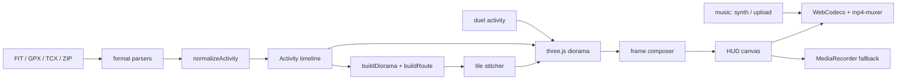

# JejakLari Local Studio

A local, browser-only port of the engine behind [jejaklari.id](https://jejaklari.id/): upload a
running activity (`.FIT`, `.GPX`, `.TCX`, `.ZIP`, `.gz`) and render a **9:16 3D map video**
with a chibi runner, telemetry HUD, cinematic cameras, music, and optional **1 vs 1 duel**.

Everything runs in the browser. Activity files never leave the device; there is no backend,
account, or upload endpoint.

> Independent reverse-engineering study. Not affiliated with or endorsed by JejakLari.

## What works

| Capability | Status |
| --- | --- |
| FIT / GPX / TCX parsing, ZIP and gzip archives | Working (real Garmin FIT fixture in tests) |
| Normalization: timestamps, jumps, elevation gain, HR/cadence fallbacks | Working |
| Real map backdrop: Esri satellite, OSM streets, CyclOSM topo, CARTO dark | Working, with offline canvas fallback |
| 3D diorama: map texture, route ribbon, progress glow, km markers, start/finish beacons | Working |
| Procedural chibi runner: gender, six hair styles, seven accessories, outfit colors | Working |
| Camera presets: Follow, Drone, Front, Side, Chase + intro orbit + finisher shot | Working |
| HUD: pace/HR/cadence/elevation, progress, distance, time, mini-map, km callouts | Working |
| Finisher recap card and duel scoreboard | Working |
| 1 vs 1 race: second activity, ghost placement, live gap, result by time or pace | Working |
| Export: MP4 H.264 + AAC, 720×1280 or 1080×1920, 30 fps, deterministic frame stepping | Working (WebCodecs + mp4-muxer) |
| Export fallback: WebM VP9/VP8 + Opus via MediaRecorder | Working |
| Music: built-in 96 BPM synth beat, uploaded audio, volume/mute, fade-out | Working |
| Download current frame as PNG | Working |
| Uploaded music (decoded, looped, faded, encoded AAC) | Working; verified by 440 Hz tone analysis |

Not ported: Strava OAuth/activity list, Overpass 3D buildings/roads enrichment, reverse-geocoded
street/location names, the multi-camera editor, cloud waitlist/share/analytics. See
[the engine report](docs/jejaklari-engine.md) for what the original does in those areas.

## Quick start

Requires Node.js 20+ and a Chromium-based browser (Chrome/Edge 119+) for MP4 export.

```sh
npm install
npm run dev
# http://127.0.0.1:5187/
```

Production build and local preview:

```sh
npm run build
npm run preview
```

The app ships with:

- `public/samples/sample-5k.gpx` — synthetic 5 km morning run around GBK Senayan, Jakarta.
- `public/samples/rival-5k.gpx` — same loop, 30 seconds faster, for duel mode.
- `public/samples/sample-run.fit` — real 5.38 km Garmin run (test data from
  [jimmykane/fit-parser](https://github.com/jimmykane/fit-parser), MIT).

## Usage

1. **Pelari** — load a file, set the runner name/BIB, style the character and outfit.
2. **Tanding** — load a second activity (or the ghost rival) for 1 vs 1.
3. **Peta** — choose map style, sky mood, camera preset, and video duration (12–60 s).
4. **Export** — choose 720p/1080p, music, then export. The MP4 downloads when rendering completes.

Preview controls: play/pause, scrub, and the five camera chips under the phone frame.
The video timeline is always intro (3.5 s or 25% of duration) → run → finisher (4 s or 25%).

## Architecture



- **Domain** (`src/domain`) — pure activity model, parsers, normalization, race comparison.
- **Engine** (`src/engine`) — geo math, tiles, scene, runner, camera, HUD, timeline, audio, exporter.
- **UI** (`src/ui`) — React studio shell; owns no rendering logic.
- **Seams** — parsers, map styles, camera poses, and exporters are registries/classes behind
  narrow interfaces so new formats/styles can be added without editing the pipeline.

## Verification

```sh
npm test        # 13 domain tests: GPX/TCX/FIT/ZIP/gzip, normalization, geo, race
npm run build   # typecheck + production bundle
```

Rendered and probed end to end in Chromium:

| Test | Result |
| --- | --- |
| 15 s, 720×1280 | H.264 Baseline, 450 frames @30 fps, AAC 48 kHz stereo, 15.02 s |
| 15 s, 1080×1920 | H.264 Baseline, 450 frames, AAC, 15.02 s |
| 30 s duel, 720×1280 | H.264, 900 frames, AAC, 30.02 s; rival pixels present |
| 12 s fallback | VP9 + Opus WebM, 720×1280 |
| Offline map | "Peta offline" fallback canvas, app remains usable |
| Header upload while another tab is open | File chooser + FIT parse verified |

Details in [docs/verification.md](docs/verification.md).

## Browser and network notes

- WebCodecs requires a secure context; `localhost` qualifies. MP4 export needs H.264 encoding
  support (Chrome/Edge). Other browsers get the WebM fallback.
- Map tiles are fetched from Esri, OpenStreetMap, and CARTO. These providers receive the tile
  coordinates (and therefore the approximate route area) plus the browser's network metadata. The
  activity file itself is never uploaded. Review provider attribution/usage policies before
  redistributing or running high-volume renders; the app prints attribution and falls back to a
  generated offline map when tiles fail.
- The default music is synthesized locally with Web Audio; no third-party track is bundled.

## Attribution

- Three.js, React, fflate, fast-xml-parser, fit-file-parser, mp4-muxer (MIT/ISC-style licenses).
- Map data © Esri, OpenStreetMap contributors, CARTO.
- FIT test fixture © the fit-parser contributors (MIT).
- Engine analysis of jejaklari.id is documented for interoperability; no original bundle or asset is
  redistributed in this repository.
