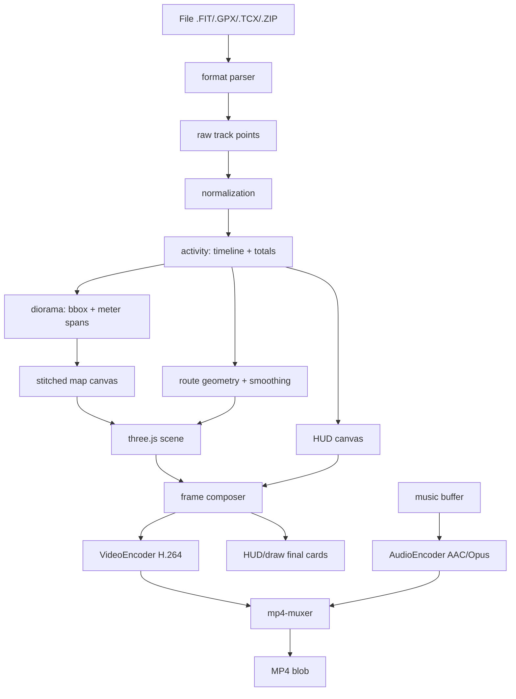

# JejakLari Studio — engine teardown and local port

Date: 2026-11-26. Target: `https://jejaklari.id/`. Method: passive HTTP fetch of the public page,
client bundles, and public API responses, followed by bundle decoding in a scratch directory.
No authentication bypass, no private data, no server-side exploitation. This document separates
**observed** facts from **inferred** intent.

## 1. What the site is

The live page is **JejakLari Studio**, an Indonesian browser app that converts run activity files
(`.FIT`, `.GPX`, `.TCX`, `.ZIP` from Strava/Garmin/Coros/Huawei/Amazfit/Apple Watch) into a
9:16 3D map video with a chibi runner, telemetry, music, and a 1 vs 1 mode.

Observed page metadata:

- Title: `JejakLari | Ubah File .FIT, .GPX, .TCX & .ZIP Lari Jadi Video 3D 9:16`
- Description: mentions 3D animation, real maps, 1 vs 1, chibi characters, background music.
- Author meta: `Davis`.
- Server: Cloudflare; `cf-cache-status: HIT`; static HTML 11,501 bytes.
- Framework: Next.js App Router (RSC flight payload, `/_next/static/chunks/app/page-*.js`,
  `BailoutToCSR` + `JejakLariStudio` component).
- Build ID: `fFPvlkfZlI_YgQh_sxoWw`.
- Initial UI is a loading shell (`Memuat JejakLari Studio...`), then a client-rendered studio.
- A separate lazy chunk contains a pre-release waitlist form (`Kabari Saya Saat Rilis`); it is not
  the main studio.

### Observed bundle inventory

| Chunk (served name) | Size | Role |
| --- | ---: | --- |
| `app/page-5e0f300d356a2ea8.js` | 264 KB | Studio UI, map composition, normalization, HUD, export orchestration |
| `b536a0f1-8bfc740a83537238.js` | 696 KB | Three.js runtime (`WebGLRenderer`, materials, geometries, loaders) |
| `3660bbdf.98ecc313902caa87.js` | 121 KB | FIT profile tables + FIT activity parser |
| `968.43448e160881723c.js` | 33 KB | FIT decoder core + Buffer helper |
| `827.ba1ebb2820dee531.js` | 31 KB | mp4-muxer (`Muxer`, `ArrayBufferTarget`, `fastStart`, WebCodecs chunks) |
| `466.ff3d1a04c59ec089.js` | 10 KB | fflate (`unzipSync`, inflate errors) |
| `163-f60515c61aa10013.js` | 9 KB | waitlist form |
| `webpack-5b7ad7c6bbc6afe1.js` | 3.9 KB | chunk loader (lazy ids 466/827/848/968) |

Hashes are recorded in §8. The page also loads React/Next runtime chunks (`117`, `101`, `972`,
`fd9d1056`, `polyfills`). The 3D runner is authored with React Three Fiber-style JSX
(`<group>`, `<mesh>`, `<capsuleGeometry>`) compiled against the Three.js module, not a prebuilt GLB.

## 2. Data flow (observed)

The export runs on a **fixed clock**, not wall time: intro frames, run frames, and finisher frames
are generated by index, and the 3D/HUD state is set explicitly for each index before encoding.

## 3. Activity ingestion and normalization

Observed parsers/format handling in the studio chunk:

- **ZIP** via fflate `unzipSync`; rejects nested/deep archives, picks an activity entry, and reads
  `.fit`, `.gpx`, or `.tcx`. Gzip is also handled.
- **FIT** via a bundled FIT profile parser; record fields include `position_lat/long` (semicircles),
  `enhanced_altitude`/`altitude`, `distance`, `speed`/`enhanced_speed`, `heart_rate`, `cadence`,
  and `timestamp`.
- **GPX/TCX** XML parsed in-browser; vendor extension keys are searched for HR/cadence.
- A synthetic sample 5K is generated at runtime when the user has no file.

Normalization behavior reconstructed from the bundle:

- Haversine distances, ignoring GPS jumps ≥ 80 m.
- If timestamps are absent, derive a time base from point density: dense files use 1 s or 0.12 s
  per sample; sparse files use distance / 2.78 m/s.
- Plausibility clamp: a segment implying > 12 m/s is capped to 5 × elapsed.
- Distance uses embedded cumulative distance when monotonic and the step is < 500 m; otherwise
  integrates the segment.
- Elevation is smoothed with `0.78 * previous + 0.22 * current`; gain only accumulates on positive
  deltas ≥ 1.5 m and resets the reference on ≤ -1.5 m.
- Speed is computed over a ±3-point window and clamped to 0.6–9.5 m/s, with average-speed fallback.
- Missing HR/cadence are synthesized from speed:
  - HR ≈ clamp(128 + (speed − 2) × 16, 115, 188)
  - cadence ≈ clamp(158 + (speed − 2) × 9, 148, 196)
- Timeline is sampled down to at most ~3,600 points; a final point is appended at total duration.
- Session distance overrides the integrated distance; a larger session duration extends the clock
  (FIT session and summed TCX lap messages).

## 4. Map and 3D diorama

Observed map behavior:

- Tile styles: Esri World Imagery + reference transportation/boundaries for **satellite**;
  OSM + CARTO Voyager for **streets**; CyclOSM + OSM for **topo**; CARTO Dark Matter for **dark**.
- Tiles are stitched into one large 2D canvas, with CSS-like filters per style (e.g. dark contrast,
  topo saturation, dark inversion fallback).
- Tile zoom starts at 18 and lowers until the grid fits 12×12 (max 3,072 px per side), with a
  1-tile margin at z17+ and 2 tiles below. The 1.9 km sample therefore uses z17 (1.19 m/px)
  instead of z15; wider routes step down to 16/15 while keeping the route at high pixel density.
- Satellite additionally paints Esri transportation and boundaries tiles over imagery; at z17+ only
  the transportation overlay is drawn to keep the label request count bounded.
- A same-origin `/api/map-tile?style=&z=&x=&y=&v=3` proxy is tried after direct tile URLs.
- The stitched canvas becomes a `CanvasTexture` on a ground plane; route and props sit above it.
- **OSM enrichment** (Overpass) fetches buildings/roads/areas along the route; caps observed at
  1,500 buildings and 950 roads. Buildings are extruded polygons with per-face colors. A
  **procedural diorama** (grid roads, roadside blocks, park/water polygons) is the fallback.
- Reverse geocoding uses Photon (`photon.komoot.io`) and ArcGIS World GeocodeServer for street and
  location names; a server route `/api/route-landmarks` can supply Overpass-derived landmarks.

Scene details observed:

- Route is projected with Web Mercator around the diorama center, scaled by `cos(latitude)`.
- Up to 4,500 route points, then 8 passes of angle-aware smoothing: straights keep 0.5, gentle
  corners 0.24, sharp corners 0.03 of the neighbor midpoint.
- Rendered as a glowing route ribbon with a dim full path, bright completed path, tip geometry,
  start/finish discs/beams, and km markers.
- Camera presets: high aerial follow (195 m behind, 420 m up, 32 m ahead target), drone/overview
  (distance derived from span), front hero (14 m), side profile (16.5 m), chase (19 m). Intro is a
  low three-quarter orbit (`span × 0.9`, capped at 2,400 m) that blends into follow; it starts around
  575 m on the 1.9 km sample instead of the drone overview. Finisher uses a 12.2 m offset shot and
  turns the runner toward the camera.
- Runner is a primitive-built chibi (head, torso, limbs, hair, accessories) scaled by camera
  distance: `clamp(1.2 + 0.044 × distance, 2.2, 85)` so the character stays readable at aerial
  distances. Finisher pose raises arms and scales to ~2.05.
- Accessories in the bundle: cap, headband, visor, trail vest with lamp, cat ears, bunny ears.
  Hair styles: undercut, spiky, side fade, bob, twintails, hijab. Jersey/shoe/skin colors are
  configurable. A canvas-baked BIB card floats above the runner.
- Sky themes: morning, day, sunset, night; the theme changes background, fog, ambient/sun/rim light.

## 5. HUD

Observed HUD composition (2D canvas over the 3D frame):

- Brand row, activity title, runner name/BIB, date, street/location.
- Four stat boxes (pace, heart rate, cadence, elevation), progress bar with percentage and
  distance/total.
- A mini-map with full route, completed route, current dot, and rival dot.
- Bottom card with a large distance readout, elapsed time, six telemetry tiles, and watermark.
- Landmark pill near a km split (reverse-geocoded/landmark data).
- Intro title card and a compact bottom finisher recap with medal, total time, distance, pace,
  average HR, cadence, elevation, and duel result. The recap leaves the scene visible above it;
  the old full-screen wash and route-map panel are gone.
- Duel header and live gap (`DUEL 1V1 • A VS B`, distance gap, winner/margin at the finish).
- Static cards are cached; dynamic overlays are redrawn each frame.

## 6. Video export

Observed export pipeline:

- 9:16 resolutions: `720×1280` or `1080×1920`; 30 fps.
- Target durations are user-selected (30 s default). Export divides the timeline into:
  - **intro**: 105 frames (3.5 s),
  - **run**: remaining frames less 120,
  - **finisher**: 120 frames (4 s).
- Video encoding via WebCodecs `VideoEncoder` with candidate H.264 codec strings:
  - 1080p: `avc1.42002a`, `avc1.420028`, `avc1.4d002a`, `avc1.4d0028`, `avc1.64002a`, `avc1.640028`
  - 720p: `avc1.420028`, `avc1.42001f`, `avc1.42E01E`, `avc1.4d0020`, `avc1.640028`
  - hardware acceleration tries `prefer-hardware`, then `no-preference`; `avc: { format: "avc" }`.
- Bitrates: 6.5 Mbps (720p), 10.5 Mbps (1080p); keyframe every 2 s; queue drain above ~4–8
  encoded frames.
- Muxing via **mp4-muxer** (observed API: `Muxer`, `ArrayBufferTarget`, `fastStart: 'in-memory'`,
  `firstTimestampBehavior: 'offset'`, `addVideoChunk`, `addAudioChunk`, `finalize`).
- Audio: decode the selected track, resample with `OfflineAudioContext`, then `AudioEncoder` AAC
  (`mp4a.40.2`, 48 kHz, stereo, 128 kbps) with Opus fallback; if no audio encoder, video-only.
  Audio is looped/trimmed to the video duration and faded at the end.
- Fallback: `canvas.captureStream(30)` + `MediaRecorder`, combining a Web Audio destination track;
  output WebM (VP9/VP8 + Opus depending on browser support).
- Final frame is a 2D canvas: 3D render drawn first, then the HUD canvas.
- Muxer chunk order may be audio-first; `firstTimestampBehavior: "offset"` aligns tracks.

## 7. Backend and adjacent features (observed + local bridge)

Observed endpoints/strings:

- `/api/strava/auth`, `/api/strava/status`, `/api/strava/activities`, `/api/strava/disconnect` —
  server-side Strava OAuth and activity listing.
- `/api/route-landmarks` — POST checkpoints; server may call Overpass; client falls back to Photon
  reverse geocoding and ArcGIS.
- `/api/map-tile` — same-origin tile proxy with style/z/x/y/version.
- Google Apps Script web app endpoint for the waitlist form.
- Cloudflare Web Analytics beacon.
- `/audio/default-bgm.mp3` — bundled background track (not redistributed here).

These require secrets/third-party services, so the local port puts an Express bridge in front:

- **Strava:** `server/strava-service.ts` performs the authorization-code exchange, token refresh,
  activity listing, stream fetch, and revoke. `server/strava-sessions.ts` keeps tokens in memory
  keyed by an httpOnly session cookie; the browser only calls `/api/strava/*`. Scopes are
  `read,activity:read_all`; only Run/TrailRun/VirtualRun are listed.
- **Overpass:** `server/overpass-service.ts` validates the padded route bbox, sends an identifying
  User-Agent, queries one endpoint at a time, caches for an hour, deduplicates in-flight requests,
  caps buildings at 1,200, and falls back from the Asia mirror `ovp.dresel.systems/api-as` to
  `maps.mail.ru` and `overpass-api.de`. Empty regional results fall through to the next endpoint;
  a failed refresh serves the last cached result with `stale: true`, and HTML gateway bodies are
  reduced to `host: timeout (504)`.
  `src/engine/osm.ts` merges footprints into one vertex-colored wall/roof mesh.
- **Not bridged:** Photon/ArcGIS reverse geocoding, OSM road/area layers, the Android waitlist
  Apps Script, and Cloudflare analytics. Tiles are fetched directly from CORS-enabled providers.

## 8. Evidence

Fetched 2026-11-26 (VPN route; the local corporate filter blocks the domain without it).

| Artifact | SHA-256 |
| --- | --- |
| `index.html` | `660d247dcd9f065b7f9f3ffb1112f154dca4b02716e87a3398ab56d8d30da74c` |
| `app/page-…js` | `5b99accd13674ff9c6f749a2c422cc33f475a9030aa669b4acda40d550898ecb` |
| `webpack-…js` | `4e379c75456cc981380857b1c35a5c79a207a6aa2c4c8faad2cb8145edf9013c` |
| `3660bbdf.…js` (FIT) | `4d883e920e821b2c4c8c95ddb645e3851c71e30a5d94fe51356d1ca51a687ded` |
| `827.…js` (mp4-muxer) | `f6c6d0514cbf7bebd2d20df3661f0fdb279d1d9c49936fb4a19e164c06d68382` |
| `466.…js` (fflate) | `031d0d78f844880112418b9b159df7b55cfb1e4a912ea87322a37bc65564ca3c` |
| `b536a0f1-…js` (Three) | `80516cc07632acad180e27657ac0a4693e3b42dfa973e0737c4d085d8055fe21` |

Observed HTTP characteristics: Cloudflare edge, `content-type: text/html`, `cf-cache-status: HIT`,
CSP `frame-ancestors 'self'`, `permissions-policy: camera=(), microphone=(), geolocation=()`.
The TLS chain on the local network is intercepted by a Fortinet gateway; validation required the
VPN route, not a disabled client check.

## 9. What the local port reproduces

| Original behavior | Port implementation |
| --- | --- |
| FIT profile parser | `fit-file-parser` 6.2.10 + semicircle/field mapping (`domain/parsers/fit.ts`) |
| fflate ZIP support | `fflate.unzipSync` with entry/depth/size guards (`domain/parsers/archive.ts`) |
| Normalization math | Reimplemented `normalizeActivity` (same jump, timing, elevation, HR/cadence rules) |
| Tile stitching + styles | `engine/tiles.ts`, direct Esri/OSM/CARTO/CyclOSM URLs, filters, cache, offline fallback |
| Diorama + route smoothing | `engine/geo.ts` (Web Mercator, cos-latitude scale, 8-pass smoothing) |
| Three.js scene + cameras | Plain Three.js `engine/scene.ts` + `engine/camera.ts`; same aerial/front/side/chase math |
| Chibi runner | Procedural `engine/runner.ts`; six hair styles, seven accessories, finisher pose, distance scaling |
| HUD/recap/duel | `engine/hud.ts`, canvas 2D, 9:16 layouts, mini-map, km pill, finisher/duel cards |
| 30 fps WebCodecs MP4 | `engine/exporter.ts`; 105 intro + 120 finish frames, same resolutions/bitrates |
| AAC audio + mp4-muxer | Same codec path and muxer semantics; synthesized default track |
| MediaRecorder fallback | `exportWebm` with VP9/VP8 + Opus, verified |
| Strava OAuth, run list, streams | `server/strava-*` + `src/api/strava.ts` + `domain/parsers/strava.ts`; mock-tested |
| Overpass buildings | `server/overpass-*` + `engine/osm.ts`; 1,200-building, cached, toggleable layer |
| Reverse geocoding, OSM roads/areas | Not ported; km markers and coordinate fallback remain |

## 10. Differences and limitations

- **No R3F**: the port uses a plain Three.js scene class. Behavior (geometry, camera math, scaling)
  is preserved; the component tree is not.
- **Buildings yes, roads/areas/geocoding no**: Overpass footprints are extruded into one mesh, but
  OSM roads, parks/water, and reverse-geocoded street names are not ported. Km markers and HUD
  callouts remain.
- **Local API bridge**: Strava OAuth and Overpass go through Express (`/api/strava`, `/api/osm`);
  map tiles are still fetched directly from CORS-enabled providers.
- **Strava tokens are memory-only**: restarting the server requires reconnecting. The client secret
  never reaches the browser.
- **Overpass is best-effort**: public instances are saturated; the Asia mirror is primary for this
  local port, with global `maps.mail.ru` / `overpass-api.de` fallbacks. A failed refresh reuses the
  last result for the area; without cache the map stays usable and the panel reports a compact error.
- **Default music is synthesized** (96 BPM, 4-chord loop) instead of the site's MP3 track.
- **HUD is redrawn per frame** rather than cached; measured export completed 450 frames of 720p in
  ~2.0–2.5 s, including 1,200 OSM buildings.
- **MediaRecorder WebM lacks a duration element** in Chromium until the file is seeked; MP4 is the
  primary path.
- **Not a pixel-perfect clone**: colors, card spacing, and labels follow the observed design but are
  an independent implementation.

## 11. Verification

See `docs/verification.md` for commands and exact ffprobe output. Summary:

- 33 tests pass: domain, Strava streams/parser, Strava OAuth bridge (mock, single-flight refresh), Overpass cache/parser/stale fallback (coalesced abort), tight-camera tracking and low intro altitude,
  and merged building geometry.
- MP4 (720p and 1080p) probed as H.264 + AAC, 450 frames at 15 s / 900 at 30 s; buildings enabled.
- WebM fallback probed as VP9 + Opus at 720×1280.
- Live Overpass load produced 1,200 buildings in 2.3 s; toggling the layer changed the WebGL frame hash; stopping the server kept the buildings with a `data OSM terakhir` status.
- Offline map, file upload, Strava UI import (intercepted API), and production server paths verified.
- Real Strava consent/revocation was not run because no credentials exist in this workspace; the
  mock exercises the same OAuth/token/stream contract.
